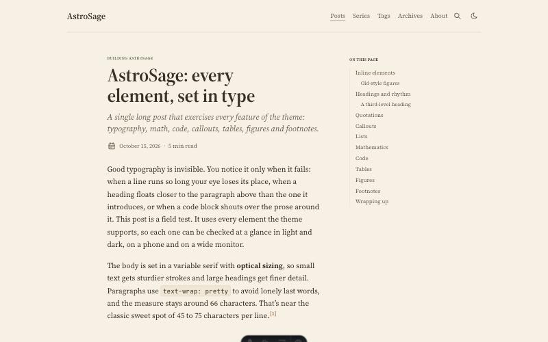
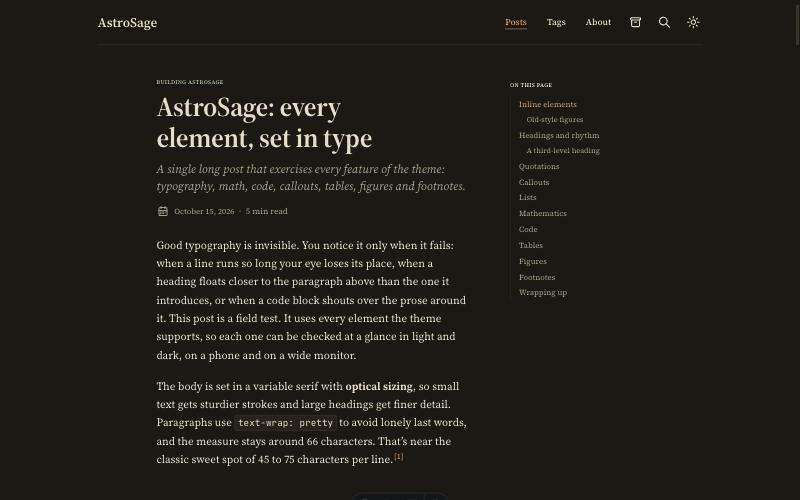
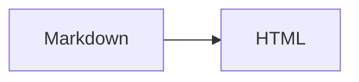

# AstroSage

A readability-first blog theme for [Astro](https://astro.build): serif type set for long reading, a warm paper palette, a table of contents that stays pinned beside the text, build-time KaTeX, Expressive Code, and optional GitHub/X sign-in comments on Cloudflare's free tier.

Forked from [AstroPaper](https://github.com/satnaing/astro-paper) by Sat Naing and rebuilt as an installable Astro integration.

| Light | Dark |
|---|---|
|  |  |

## Features

- **Typography:** Newsreader for reading (or Source Serif 4 / Literata) with JetBrains Mono for the UI, self-hosted with metric-matched fallbacks (CLS 0). 18.5px body, a column clamped to 66–71 characters per line, `text-wrap: pretty`, old-style figures, optional optical sizing.
- **Warm palette:** warm paper in light mode, espresso in dark. Every colour is a CSS variable in one file and is WCAG-checked.
- **Pinned TOC:** a right rail at ≥ 1280px that highlights the section you're reading. It becomes a collapsible "On this page" block on smaller screens.
- **Math:** `$…$` and `$$…$$` rendered by KaTeX at build time. No math JavaScript, and KaTeX CSS loads only on posts that use it.
- **Code:** Expressive Code with Gruvbox, "hairline" blocks (no fill, a 1px frame) that sit on the paper, titles, line numbers, high-contrast diff lines, collapsible sections, terminal frames and a copy button. Every token is ≥ 5.5:1 against the page.
- **Diagrams:** Mermaid and Excalidraw (inline JSON, share links or files), rendered at build time to inline SVG that matches the palette. Includes a zoom/pan viewer and a full-width option. See below.
- **Callouts:** GitHub alerts (`> [!NOTE]`) or directives (`:::warning[Title]`). Both produce the same markup.
- **Series:** `series: "Name"` in frontmatter gives an index page, a per-series page and "Part N of M" navigation.
- **Comments (optional):** GitHub and X sign-in, comments, replies, edit, delete and moderation on Cloudflare Workers + D1 (free tier). Off by default.
- Pagefind search, RSS, sitemap, generated OG images, reading time, archives, tags, native view transitions.
- About 2.8 KB of gzipped JS on an article page. Lighthouse desktop 100/100/100/100.

## Quick start

```bash
pnpm add astro-sage
```

```ts
// astro.config.ts
import { defineConfig } from "astro/config";
import astroSage from "astro-sage";
import sageConfig from "./sage.config";

export default defineConfig({
  site: sageConfig.site.url,
  integrations: [astroSage(sageConfig)],
});
```

```ts
// src/content.config.ts
import { defineSageCollections } from "astro-sage/content";
import config from "../sage.config";

export const collections = defineSageCollections({ author: config.site.author });
```

```ts
// sage.config.ts
import { defineSageConfig } from "astro-sage";

export default defineSageConfig({
  site: {
    url: "https://example.com/",
    title: "My notes",
    description: "Things I learned.",
    author: "Ada Lovelace",
  },
  typography: { serif: "newsreader" }, // default; or "source-serif-4" | "literata"
  home: { intro: "A short paragraph shown on the home page." },
});
```

Write posts in `src/content/posts/` (`.md` or `.mdx`; a folder with `index.mdx` works too) and pages in `src/content/pages/` (`about.md`). The theme injects every route, so your site needs no page files.

### Frontmatter

```yaml
title: "Attention is all you need, annotated"
description: "One-line summary used in lists, RSS and meta tags."
pubDatetime: 2026-10-15T09:00:00Z
tags: ["ml", "transformers"]
series: "Reading papers"   # optional
featured: true             # optional
toc: true                  # default true
math: true                 # default true; set false to skip KaTeX CSS
comments: true             # default true (when comments are configured)
```

## Diagrams

````md


```excalidraw title="Pasted from Excalidraw"
{ "type": "excalidraw/clipboard", "elements": [ ... ] }
```


````

Diagrams are rendered once, at build time, in headless Chromium (`pnpm add -D playwright && npx playwright install chromium`, or an installed Chrome). The SVG is cached in `.sage-cache/diagrams/`. **Commit that folder**, and deploy builds won't need a browser or network. Add `wide` or `full` (a code-fence flag or the image title) to break out of the column. See Breakout figures below. Readers can expand any diagram into a zoom/pan viewer. Design notes: [docs/decisions/005-code-and-diagrams.md](docs/decisions/005-code-and-diagrams.md).

## Breakout figures

Images, diagrams and figures come in three sizes, written the same way everywhere:

| Size | Width | Markdown image / Excalidraw | Diagram fence | Component |
|---|---|---|---|---|
| column | the reading column | `` | ` ```mermaid ` | `<Figure src={x} alt="…" />` |
| wide | column + TOC rail (up to 64rem without the rail) | `` | ` ```mermaid wide ` | `<Figure … size="wide" />` |
| full | the whole viewport, minus the page gutter on each side | `` | ` ```mermaid full ` | `<Figure … size="full" />` |

Captions on `full` figures stay on the reading column. The pinned TOC fades out while a `wide` or `full` figure passes beneath it. Markdown images use their alt text as the caption.

## Comments (Cloudflare Workers + D1)

1. Add the adapter, and keep prerendering in Node so build-time tools work:
   ```ts
   import cloudflare from "@astrojs/cloudflare";
   export default defineConfig({
     adapter: cloudflare({ prerenderEnvironment: "node", imageService: "compile" }),
     integrations: [astroSage(sageConfig)],
   });
   ```
2. Turn comments on in `sage.config.ts`:
   ```ts
   comments: { provider: "cloudflare-d1", admins: ["github:your-login"] },
   ```
3. Create the database and apply the migration (see [`apps/demo/wrangler.jsonc`](apps/demo/wrangler.jsonc) for the binding):
   ```bash
   wrangler d1 create my-blog
   wrangler d1 migrations apply my-blog --remote
   ```
4. Create OAuth apps:
   - **GitHub:** Settings → Developer settings → OAuth Apps. Callback URL `https://<your-site>/api/auth/callback/github`.
   - **X:** developer.x.com → Project → App → User authentication (OAuth 2.0, type "Web App"). Callback URL `https://<your-site>/api/auth/callback/twitter`.
5. Add secrets (`.dev.vars` locally, `wrangler secret put` in production): `BETTER_AUTH_SECRET`, `GITHUB_CLIENT_ID`, `GITHUB_CLIENT_SECRET`, `X_CLIENT_ID`, `X_CLIENT_SECRET`.

Pages stay static. Only `/api/auth/*` and `/api/comments*` run on the Worker. See [docs/decisions/004-comments.md](docs/decisions/004-comments.md) for the design.

## Developing the theme

```bash
pnpm install
pnpm dev        # demo site at http://localhost:4321, showcase at /posts/showcase/
pnpm build
pnpm test       # Playwright + axe, desktop and mobile
pnpm lint && pnpm format:check
```

The showcase post (`apps/demo/src/content/posts/showcase/index.mdx`) exercises every feature and is what the tests run against.

## Upgrading from AstroPaper

| AstroPaper | AstroSage |
|---|---|
| `astro-paper.config.ts` | `sage.config.ts` with `defineSageConfig` (same `site`, `posts`, `features`, `socials`, `shareLinks`, plus `typography`, `home`, `comments`) |
| `src/pages/*` in your repo | injected by the integration |
| `## Table of contents` heading | automatic right-rail TOC (`toc: false` to hide) |
| rehype-callouts syntax | GitHub alerts or `:::type[Title]` |
| Shiki transformers (`// [!code ++]`) | Expressive Code meta: `ins={4}`, `del={3}`, `{1-2}`, `"word"`, `collapse={1-4}` |

## Repository layout

```
packages/astro-sage/   the theme (integration, routes, components, styles, markdown plugins, comments)
apps/demo/             demo site and showcase post; Playwright tests
docs/decisions/        architecture decision records
```

## License

MIT. See [LICENSE](LICENSE). Based on AstroPaper © Sat Naing.
