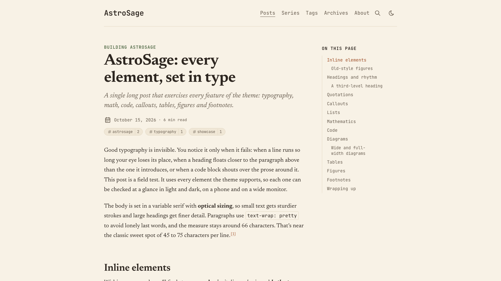
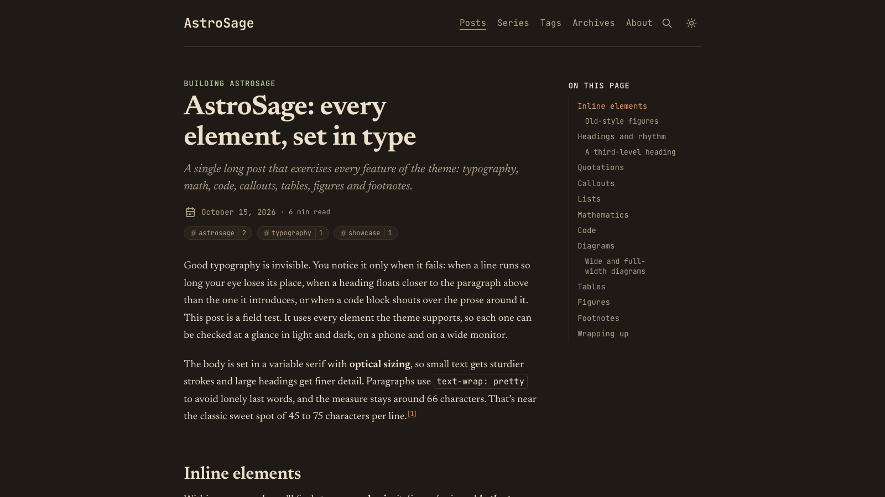
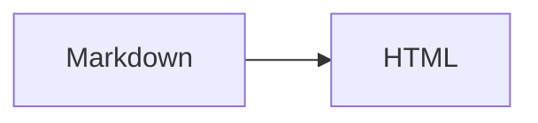

# AstroSage

A readability-first blog theme for [Astro](https://astro.build): serif type set for long reading, a warm paper palette, a table of contents that stays pinned beside the text, build-time KaTeX, Expressive Code, and optional GitHub/X sign-in comments on Cloudflare's free tier.

**Live demo:** [astro-sage.chintak.sh](https://astro-sage.chintak.sh) · **Every element on one page:** [the showcase post](https://astro-sage.chintak.sh/posts/showcase/) · **All features:** [FEATURES.md](FEATURES.md)

Built for Astro 7 with Tailwind CSS 4, MDX, Expressive Code, KaTeX and Pagefind. Forked from [AstroPaper](https://github.com/satnaing/astro-paper) by Sat Naing and rebuilt as an Astro integration.

| Light | Dark |
|---|---|
|  |  |

## Features

- **Typography:** Newsreader for reading (or Source Serif 4 / Literata) with JetBrains Mono for the UI, self-hosted with metric-matched fallbacks (CLS 0). 18.5px body, a column clamped to 66–71 characters per line, `text-wrap: pretty`, old-style figures, optional optical sizing.
- **Warm palette:** warm paper in light mode, espresso in dark. Every colour is a CSS variable in one file and is WCAG-checked.
- **Pinned TOC:** a right rail at ≥ 1280px that highlights the section you're reading. It becomes a collapsible "On this page" block on smaller screens.
- **Math:** `$…$` and `$$…$$` rendered by KaTeX at build time. No math JavaScript, and KaTeX CSS loads only on posts that use it.
- **Code:** Expressive Code with Gruvbox, "hairline" blocks (no fill, a 1px frame) that sit on the paper, titles, a language label on the frame (e.g. "TypeScript"), line numbers, high-contrast diff lines, collapsible sections, terminal frames and a copy button. Every token is ≥ 5.5:1 against the page.
- **Diagrams:** Mermaid and Excalidraw (inline JSON, share links or files), rendered at build time to inline SVG that matches the palette. Includes a zoom/pan viewer and a full-width option. See below.
- **Callouts:** GitHub alerts (`> [!NOTE]`) or directives (`:::warning[Title]`). Both produce the same markup.
- **Task lists:** round checkboxes; done items get a sage tick and are struck through.
- **Wiki-links:** `[[slug]]`, `[[slug|text]]`, `[[slug#Heading]]` and `[[#Heading]]` link posts by slug, path or title (case-insensitive), titled for you. A target that's missing, a draft or still scheduled renders as muted text and warns at build time. Inside a table, escape the pipe: `[[slug\|text]]`.
- **Link styles:** links to other sites get a small ↗ (and `rel="noopener"`); links within the site keep a plain underline.
- **Series:** `series: "Name"` in frontmatter gives an index page, a per-series page and "Part N of M" navigation.
- **Comments (optional):** [utterances](https://utteranc.es) (GitHub Issues) or [giscus](https://giscus.app) (GitHub Discussions), loaded only when readers scroll to them and kept in sync with the light/dark toggle. No server or database. Off by default.
- **Sharing:** X, LinkedIn, Bluesky, Reddit, Hacker News and email, plus copy-link and the native share sheet on supporting devices. Configure with `shareLinks` (`{url}` / `{title}` placeholders).
- **Quote sharing:** select any passage to share it with a link that scrolls to that passage (a text fragment), or as an image: a 1200×630 quote card drawn in the browser, handed to the native share sheet on phones or downloaded as `quote.png` on desktop. Nothing is pre-rendered and no server is involved; the code loads only after the first selection.
- **Citations:** a folded "Cite this post" block (not a heading, so it stays out of the TOC) with a text citation and copyable BibTeX on every post (`citation: { author: "Sheth, Chintak" }`; `cite: false` in frontmatter to hide).
- Pagefind search, RSS, sitemap, generated OG images, reading time, archives, tags with post counts, native view transitions.
- About 2.8 KB of gzipped JS on an article page. Lighthouse desktop 100/100/100/100.

## Get started

Requires Node 22.12+ and [pnpm](https://pnpm.io) (the template is a pnpm workspace).

```bash
pnpm create astro@latest my-blog --template chintak/astro-sage
cd my-blog
pnpm dev
```

This gives you the theme (`packages/astro-sage`) and a ready-to-edit site (`apps/demo`), the same code that runs the live demo. Make it yours:

1. Edit `apps/demo/sage.config.ts`: site URL, title, author, socials.
2. Replace the posts in `apps/demo/src/content/posts/` and the page in `apps/demo/src/content/pages/about.md`.
3. `pnpm build` writes the site to `apps/demo/dist/`. It's a plain static site: deploy it to any static host (Netlify, Vercel, GitHub Pages, Cloudflare, S3, your own server). The live demo happens to use Cloudflare (`pnpm deploy:demo`, configured in `apps/demo/wrangler.jsonc`); you can delete that file.

### Add it to an existing Astro site

AstroSage isn't on npm; pin a release tag from git. In a pnpm workspace:

```bash
git submodule add https://github.com/chintak/astro-sage vendor/astro-sage
git -C vendor/astro-sage checkout astro-sage@0.1.1
```

Add `vendor/astro-sage/packages/*` to `pnpm-workspace.yaml`, then `"astro-sage": "workspace:*"` to your site's dependencies, and wire it up:

```ts
// astro.config.ts
import { defineConfig } from "astro/config";
import astroSage from "astro-sage";
import sageConfig from "./sage.config";

export default defineConfig({
  site: sageConfig.site.url,
  integrations: [astroSage(sageConfig)],
});
```

```ts
// src/content.config.ts
import { defineSageCollections } from "astro-sage/content";
import config from "../sage.config";

export const collections = defineSageCollections({ author: config.site.author });
```

```ts
// sage.config.ts
import { defineSageConfig } from "astro-sage";

export default defineSageConfig({
  site: {
    url: "https://example.com/",
    title: "My notes",
    description: "Things I learned.",
    author: "Ada Lovelace",
  },
  typography: { serif: "newsreader" }, // or "source-serif-4" | "literata"
  home: { intro: "A short paragraph shown on the home page." },
});
```

Every option is listed in [FEATURES.md](FEATURES.md#configuration-sageconfigts).

Write posts in `src/content/posts/` (`.md` or `.mdx`; a folder with `index.mdx` works too) and pages in `src/content/pages/` (`about.md`). The theme injects every route, so your site needs no page files.

### Frontmatter

```yaml
title: "Attention is all you need, annotated"
description: "One-line summary used in lists, RSS and meta tags."
pubDatetime: 2026-10-15T09:00:00Z
tags: ["ml", "transformers"]
series: "Reading papers"   # optional
featured: true             # optional
toc: true                  # default true
math: true                 # default true; set false to skip KaTeX CSS
comments: true             # default true (when comments are configured)
cite: true                 # default true: show the "Cite this post" block
```

## Diagrams

````md


```excalidraw title="Pasted from Excalidraw"
{ "type": "excalidraw/clipboard", "elements": [ ... ] }
```


````

Diagrams are rendered once, at build time, in headless Chromium (`pnpm add -D playwright && npx playwright install chromium`, or an installed Chrome). The SVG is cached in `.sage-cache/diagrams/`. **Commit that folder**, and deploy builds won't need a browser or network. Add `wide` or `full` (a code-fence flag or the image title) to break out of the column. See Breakout figures below. Readers can expand any diagram into a zoom/pan viewer. Design notes: [docs/decisions/005-code-and-diagrams.md](docs/decisions/005-code-and-diagrams.md).

## Breakout figures

Images, diagrams and figures come in three sizes, written the same way everywhere:

| Size | Width | Markdown image / Excalidraw | Diagram fence | Component |
|---|---|---|---|---|
| column | the reading column | `` | ` ```mermaid ` | `<Figure src={x} alt="…" />` |
| wide | column + TOC rail (up to 64rem without the rail) | `` | ` ```mermaid wide ` | `<Figure … size="wide" />` |
| full | the whole viewport, minus the page gutter on each side | `` | ` ```mermaid full ` | `<Figure … size="full" />` |

Captions are centred under the figure. The pinned TOC fades out while a `wide` or `full` figure passes beneath it. Markdown images use their alt text as the caption.

## Comments

AstroSage builds a fully static site, so comments come from a GitHub-backed widget that runs in the reader's browser. Pick one in `sage.config.ts`:

```ts
// utterances: one GitHub issue per post. Install https://github.com/apps/utterances on the repo.
comments: { provider: "utterances", repo: "you/your-repo", label: "comments" },

// giscus: one GitHub Discussion per post, with reactions. Enable Discussions,
// install https://github.com/apps/giscus, and copy the ids from https://giscus.app.
comments: {
  provider: "giscus",
  repo: "you/your-repo",
  repoId: "R_…",
  category: "Comments",
  categoryId: "DIC_…",
},
```

Both load only when the comments section nears the viewport, follow the theme toggle, and accept `theme: { light, dark }` (a theme name, or for giscus a CSS URL). Readers sign in with GitHub. Set `comments: false` in a post's frontmatter to hide them there.

## Developing the theme

```bash
pnpm install
pnpm dev        # demo site at http://localhost:4321, showcase at /posts/showcase/
pnpm build
pnpm test       # Playwright + axe, desktop and mobile
pnpm lint && pnpm format:check
```

The showcase post (`apps/demo/src/content/posts/showcase/index.mdx`) exercises every feature and is what the tests run against.

## Upgrading from AstroPaper

| AstroPaper | AstroSage |
|---|---|
| `astro-paper.config.ts` | `sage.config.ts` with `defineSageConfig` (same `site`, `posts`, `features`, `socials`, `shareLinks`, plus `typography`, `home`, `comments`) |
| `src/pages/*` in your repo | injected by the integration |
| `## Table of contents` heading | automatic right-rail TOC (`toc: false` to hide) |
| rehype-callouts syntax | GitHub alerts or `:::type[Title]` |
| Shiki transformers (`// [!code ++]`) | Expressive Code meta: `ins={4}`, `del={3}`, `{1-2}`, `"word"`, `collapse={1-4}` |

## Versioning

AstroSage follows [SemVer](https://semver.org). Releases are git tags (`astro-sage@0.1.1`) with notes in [`packages/astro-sage/CHANGELOG.md`](packages/astro-sage/CHANGELOG.md) and on [GitHub Releases](https://github.com/chintak/astro-sage/releases). Changes are recorded with [Changesets](.changeset/README.md).

## Repository layout

```
packages/astro-sage/   the theme (integration, routes, components, styles, markdown plugins, comments)
apps/demo/             demo site and showcase post; Playwright tests
docs/decisions/        architecture decision records
FEATURES.md            every feature, option and frontmatter field, with examples
AGENTS.md              conventions for contributors and coding agents
```

## License

MIT. See [LICENSE](LICENSE). Based on AstroPaper © Sat Naing.
